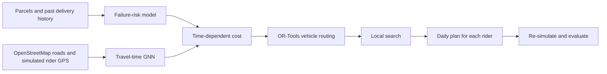

# MilliMetre: Risk-Aware Last-Mile Delivery Routing

A research prototype for planning parcel deliveries in a city such as Bengaluru. It tests whether delivery routes can be made cheaper by considering two things together:

1. **Will the customer be available when the rider arrives?**
2. **How long will each road take at that time of day?**

The project combines machine learning, a graph neural network, and a vehicle-routing optimiser to create an ordered delivery plan for each rider.

> **Project status:** This is a simulation-based research prototype, not a production dispatch system. Its results are simulated and have not been validated using real courier operations.

## Why this problem matters

A route that looks short on a map can still be expensive. A customer may not be home, a cash-on-delivery parcel may be refused, or a road may be slow at the time the rider reaches it. Failed attempts and wasted rider time add cost.

This project explores a planner that looks beyond distance. It tries to schedule each delivery at a sensible time, account for changing road conditions, and compare the resulting plan with simpler routing approaches.

## How the project works



**1. Predict delivery risk.** The notebook estimates the chance that a first delivery attempt will fail at different arrival times. It compares logistic regression, XGBoost, and a GRU-based neural network called *FailNet*. The failure categories are customer not home, cash-on-delivery refusal, and address problems.

**2. Predict road travel time.** The road network is treated as a graph. Intersections are nodes and road segments are edges. A graph neural network (GNN) estimates how travel time changes with the hour, day of the week, and rain conditions. It is compared with simpler baselines, including an MLP that does not use the graph structure.

**3. Plan the routes.** Google OR-Tools creates an initial vehicle-routing plan. A local-search step then improves it using time-dependent travel estimates, delivery-risk estimates, rider shifts, capacity, overtime, and delivery-slot penalties. The planner can also consider postponing a parcel.

**4. Evaluate the plans.** Each planner handles the same test parcels. The notebook then replays the plans inside the simulator using the same simulated customer behaviour and traffic, so the comparisons are made on a consistent basis.

## Data: what is real and what is simulated

The road geometry is downloaded from **OpenStreetMap** for a small area of south-east Bengaluru covering Koramangala, BTM, HSR, and Madiwala.

Everything else is synthetic:

- customer profiles and when customers are likely to be home;
- parcels and cash-on-delivery behaviour;
- delivery outcomes and failure reasons;
- traffic conditions and rider GPS traversals.

The notebook creates this simulated world through `simulator.py`. It keeps observable input tables in `data/` and hidden simulator state in `ground_truth/`. The hidden state is used only to score plans and for diagnostics clearly marked as synthetic-only. It is not real customer or courier data.

The saved notebook run contains 6,000 simulated customers, 120 simulated days, 28,924 delivery attempts, and 261,994 simulated GPS traversals. The road graph has 5,076 nodes and 12,896 directed edges. A fresh OpenStreetMap download may produce a slightly different graph and different results.

## Results from the saved notebook run

The notebook compares five planners on **10 held-out test days**. The main comparison is shown below.

| Planner | What it uses | Mean simulated cost per hub-day | Cost per delivered parcel |
|---|---|---:|---:|
| P1 — Distance-only VRP | Free-flow travel times and distance-oriented routing | ₹10,451.42 | ₹42.09 |
| P2 — Time-aware | GNN travel-time estimates | ₹9,581.74 | ₹38.71 |
| P3b — Risk-aware + deferral | GNN travel times, predicted failure risk, and optional deferral | ₹9,552.32 | ₹38.57 |
| P4 — Oracle risk | GNN travel times and the simulator's true failure probabilities | ₹8,731.12 | ₹35.32 |

Compared with the distance-only baseline, P3b reduced simulated operating cost by about **₹899 per hub-day (8.6%)**. At the simulated volume of roughly 247 parcels per day, this is approximately **₹3.64 per parcel**, using the simulator's assumed cost of ₹90 per failed attempt.

There is an important qualification. Most of the improvement comes from using time-aware road travel estimates. The additional difference between P2 and P3b—the contribution of the learned failure-risk model and deferral—is about **₹29 per hub-day**, with a 95% confidence interval of approximately **±₹178**. This interval includes zero, so this 10-day evaluation does not establish a clear additional benefit from the risk-aware layer.

There are limitations in the model results too. On road edges completely held out from training, the GNN's log-ratio MAE is 0.1794, while the non-graph MLP reaches 0.1701. The GNN is therefore not the best model on that particular held-out-edge metric.

**Please treat these numbers as results from a controlled simulation, not as proven savings for a real courier company.** The next meaningful test is a pilot using anonymised delivery histories and rider GPS from an actual hub.

## Run the notebook

### Google Colab

1. Open `lastmile_pipeline (1).ipynb` in Google Colab.
2. Keep `USE_OSM = True` to download the Bengaluru road network. This requires internet access.
3. Set `FAST = True` for a shorter evaluation. Set it to `False` for the full 10-day evaluation.
4. Choose **Runtime → Run all** and let the notebook run from top to bottom.

The notebook installs `osmnx`, `ortools`, and `folium` automatically in Colab. The full run is computationally heavy and may take tens of minutes on a free CPU runtime.

### Run locally

Use Python 3.10 or newer. Create a virtual environment and install the dependencies:

```bash
python -m venv .venv

# macOS / Linux
source .venv/bin/activate

# Windows PowerShell
# .venv\\Scripts\\Activate.ps1

python -m pip install --upgrade pip
pip install -r requirements.txt
jupyter notebook
```

Open `lastmile_pipeline (1).ipynb` and run the cells in order. The first run needs internet access when `USE_OSM = True`, because the road network is downloaded from OpenStreetMap.

## Read the evaluation step by step

The original notebook builds the simulator, trains the models, optimises delivery routes, and saves its evaluation files. A separate, more readable companion notebook explains those results in smaller steps:

- `notebooks/MilliMetre_Results_Walkthrough.ipynb` — inspect delivery failures, compare classifier and travel-time metrics, calculate paired planner savings with confidence intervals, review the misspecification test, and view an exported rider plan.

**Run order:** execute `lastmile_pipeline (1).ipynb` first; then open the walkthrough notebook. The walkthrough reads files from the generated `lastmile_run/` folder (or `/content/lastmile/` in Colab). It does not retrain the models.

## Files in this repository

```text
millimetre-last-mile-routing/
├── README.md
├── lastmile_pipeline (1).ipynb
├── requirements.txt
└── .gitignore
```

The notebook generates the simulator, data, model files, evaluation tables, and sample rider-plan exports when it runs. These generated files are excluded from Git by `.gitignore`; they are not required to understand the source notebook. In particular, keep `ground_truth/` out of any real-world data release because it contains the simulator's hidden state.

## Assumptions and next steps

Rider costs, fuel costs, customer behaviour, service times, failure penalties, and other operating values are assumptions in the simulator. They should be calibrated with evidence before the project is used to make operational or commercial claims.

A useful real-world pilot would compare the current routing process with this planner on alternating days or riders. It should measure realised cost per delivered parcel, first-attempt success, overtime, distance, and model performance for customers with different amounts of delivery history.

## License

No license is included yet. A license should be added before others are invited to reuse, modify, or redistribute the code.
